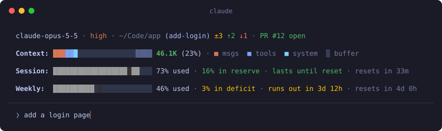

<h1 align="center">claude-status-bar-mod</h1>

<p align="center">
  <b>Know how much context, session and week you have left, without asking</b>
</p>

<p align="center">
  <a href=".claude-plugin/plugin.json"></a>
  <a href="LICENSE"></a>
  
  <a href="https://github.com/skryvets/claude-status-bar-mod/stargazers"></a>
</p>

A [Claude Code](https://claude.com/claude-code) mod that draws four lines above the prompt: where you are, what fills the context window, and how fast you spend your subscription limits

- **Pace, not only percent.** `73% used` says little on its own. The bar compares it with the time passed in the window and tells you `16% in reserve · lasts until reset` or `3% in deficit · runs out in 3d 12h`
- **Context you can read at a glance.** One bar stacked by what fills the window (messages, tools, MCP, memory, skills, system prompt), with the autocompact buffer marked at the end
- **Git and pull request in the same line.** Files changed, commits to push and pull, and the state of the branch's pull request, kept current in the background

<p align="center">
  
</p>
<p align="center">
  <em>Illustration of the bar. Colours follow your Claude Code theme</em>
</p>

**Get started** (10 seconds). Type this at the prompt of a Claude Code terminal session:

```
/plugin install session --marketplace skryvets/claude-status-bar-mod
```

Answer `y` to add the marketplace, then pick the user scope. That is all: the bar appears above the prompt

> [!NOTE]
> Mods are an early access feature of Claude Code, so the API this uses may change between releases. Written against Claude Code 2.1.296

---

## What it shows

| Line | What you get |
| --- | --- |
| **Top line** | Model, effort level, folder, git branch, git state and the branch's pull request |
| **Context** | One bar stacked by category, the free space and the autocompact buffer, then tokens used and percent |
| **Session** | The 5 hour subscription limit: time passed, usage marker, percent used, pace, forecast, time until reset |
| **Weekly** | The 7 day subscription limit, drawn the same way |

The same thing as plain text:

```
claude-opus-5-5 · high · ~/Code/app (add-login) ±3 ↑2 ↓1 · PR #12 open

Context: ██████░░░░░░░░░░░░░░▒▒▒▒ 46.1K (23%) · ■ msgs  ■ tools  ■ system  ▒ buffer

Session: █████████████████████░░░ 73% used · 16% in reserve · lasts until reset · resets in 33m

Weekly:  ██████████░█░░░░░░░░░░░░ 46% used · 3% in deficit · runs out in 3d 12h · resets in 4d 0h
```

## How to read the git state

| Sign | Meaning |
| --- | --- |
| `±N` | Files with uncommitted changes, untracked files included |
| `↑N` | Commits not pushed to the upstream branch. A bare `↑` is a branch that has no upstream yet, in a repo that has a remote |
| `↓N` | Commits on the upstream branch to pull |
| `PR #N open` / `merged` / `closed` | The pull request of the current branch |

- The bar runs `git fetch` once a minute and at the end of each turn to keep `↓N` current. A remote that asks for a password is skipped
- The pull request is read with the [GitHub CLI](https://cli.github.com) once a minute and at the end of each turn. Nothing is shown without `gh`, or when the branch has no pull request

## How to read the context bar

- The bar has one colour per category, named by the legend after it. Messages are in the accent colour
- `░` is free space and `▒` is the autocompact buffer, the reserve at the end of the window: auto-compaction runs when usage reaches it
- The filled part is true to size to the nearest cell, and each category takes its share of it to the nearest half cell
- `▌` is a cell split between two categories. A category too small for half a cell is named in the legend but not drawn
- The token count is green, then yellow at 70% and red at 90%
- The legend is the first thing cut on a narrow terminal

## How to read the pace

The limit bars fill with the **time passed** in the window, and a darker cell marks **how much of the limit is used**. A marker inside the fill is reserve, at its edge is on pace, past it is deficit

| Text | Meaning | Colour |
| --- | --- | --- |
| `on pace` | Within 2 points of spending the limit evenly across the window | Green |
| `N% in reserve` | You have used less than even spending would | Green |
| `N% in deficit` | You have used more than even spending would | Yellow, red past 12 points |
| `lasts until reset` / `runs out in …` | A straight-line forecast from your spending so far | Same as the pace |
| `limit reached` | The limit is fully used | Red |

No pace is shown until 3% of the window has passed (9 minutes for Session, about 5 hours for Weekly)

## Show and hide

Type `/status-bar-mod` to hide the bar, and again to show it. The choice is kept between sessions

## Privacy

Everything runs on your machine. The bar reads session data from Claude Code and runs `git status`, `git remote`, `git fetch` and `gh pr view` in your folder. The last two talk to your own git remote and to GitHub, and nothing is sent anywhere else

## Notes

- The effort level appears after the first prompt of a session
- Until the first response of a session, or after a compaction, the context count is the same estimate `/context` shows
- The blank rows above and between the lines are dropped when the prompt grows and leaves the band too few rows
- Limits only show on a Claude subscription

## Development

```
claude plugin validate .
claude plugin test .
claude --plugin-dir .
```

All of the mod is in [`hooks/register.tsx`](hooks/register.tsx), and its tests are in [`tests/session.test.tsx`](tests/session.test.tsx)

## Credits

The pace rules follow [CodexBar](https://github.com/steipete/CodexBar) by Peter Steinberger

The stacked context bar follows [context-bar](https://github.com/hamzafer/claude-code-mods) by Hamza Zafar

## License

[MIT](LICENSE)
